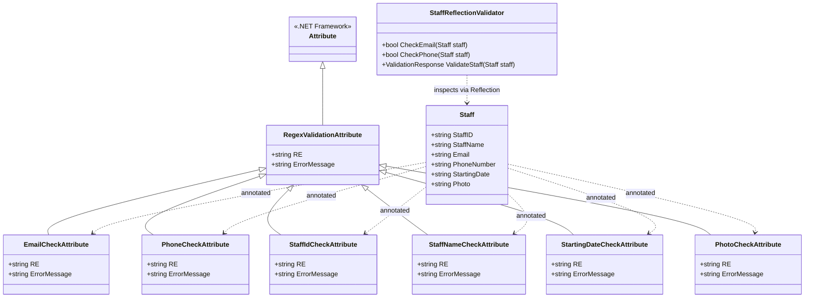
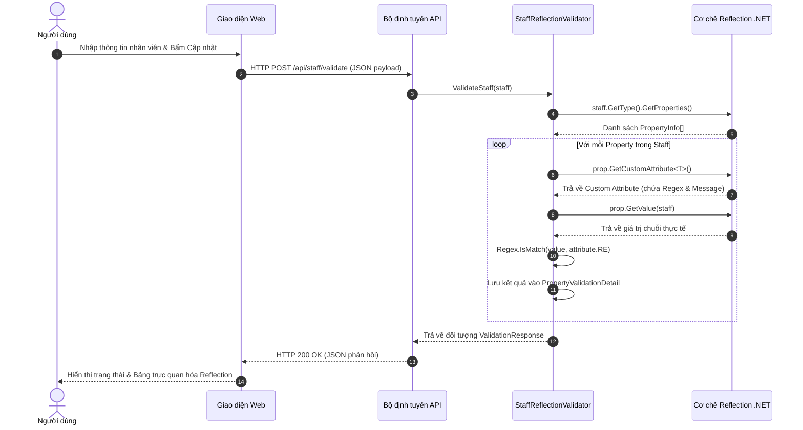

# BÁO CÁO THỰC HÀNH BUỔI 3: KIỂM CHỨNG MÔ HÌNH

## CHỦ ĐỀ: REGULAR EXPRESSIONS, ATTRIBUTES VÀ REFLECTION TRONG KIỂM TRA TÍNH HỢP LỆ DỮ LIỆU

---

### THÔNG TIN CHUNG

- **Cơ sở đào tạo:** Trường Công nghệ Thông tin & Truyền thông – Đại học Cần Thơ
- **Học phần:** Kiểm chứng mô hình
- **Buổi thực hành:** Buổi 3 – Session 5: Regular Expressions
- **Giảng viên hướng dẫn:** TS. Lâm Hoài Bảo
- **Sinh viên thực hiện:**
  1. **Nguyễn Phước Lộc** – MSSV: **B2303828**
  2. **Trần Trọng Phúc** – MSSV: **B2303844**
- **Lớp:** DI2396A1
- **Khóa:** 49
- **Thời gian thực hiện:** Tháng 10/2026

---

## MỤC LỤC

- [1. Tiêu đề](#1-tiêu-đề)
- [2. Tóm tắt](#2-tóm-tắt)
- [3. Đặt vấn đề](#3-đặt-vấn-đề)
- [4. Khái niệm liên quan](#4-khái-niệm-liên-quan)
  - [4.1. Biểu thức chính quy](#41-biểu-thức-chính-quy)
  - [4.2. Thuộc tính tùy biến trong C#](#42-thuộc-tính-tùy-biến-trong-c)
  - [4.3. Cơ chế phản chiếu trong .NET](#43-cơ-chế-phản-chiếu-trong-net)
  - [4.4. So sánh phương pháp thẩm định truyền thống và Reflection + Attributes](#44-so-sánh-phương-pháp-thẩm-định-truyền-thống-và-reflection--attributes)
- [5. Công việc thực hiện](#5-công-việc-thực-hiện)
  - [5.1. Thiết kế kiến trúc ứng dụng](#51-thiết-kế-kiến-trúc-ứng-dụng)
  - [5.2. Nguyên lý hoạt động của hệ thống](#52-nguyên-lý-hoạt-động-của-hệ-thống)
  - [5.3. Cài đặt chi tiết chương trình và các Biểu thức chính quy](#53-cài-đặt-chi-tiết-chương-trình-và-các-biểu-thức-chính-quy)
    - [5.3.1. Xây dựng Model Nhân viên (`Staff`)](#531-xây-dựng-model-nhân-viên-staff)
    - [5.3.2. Cài đặt các Custom Attributes](#532-cài-đặt-các-custom-attributes)
    - [5.3.3. Xây dựng dịch vụ thẩm định bằng Reflection (`StaffReflectionValidator`)](#533-xây-dựng-dịch-vụ-thẩm-định-bằng-reflection-staffreflectionvalidator)
    - [5.3.4. Phân tích chuyên sâu Biểu thức chính quy các trường dữ liệu](#534-phân-tích-chuyên-sâu-biểu-thức-chính-quy-các-trường-dữ-liệu)
      - [Biểu thức chính quy Số điện thoại chuẩn Việt Nam (Bài tập 2)](#biểu-thức-chính-quy-số-điện-thoại-chuẩn-việt-nam-bài-tập-2)
      - [Biểu thức chính quy Địa chỉ thư điện tử](#biểu-thức-chính-quy-địa-chỉ-thư-điện-tử)
      - [Biểu thức chính quy Mã nhân viên](#biểu-thức-chính-quy-mã-nhân-viên)
      - [Biểu thức chính quy Họ và tên](#biểu-thức-chính-quy-họ-và-tên)
      - [Biểu thức chính quy Ngày bắt đầu làm việc](#biểu-thức-chính-quy-ngày-bắt-đầu-làm-việc)
      - [Biểu thức chính quy Ảnh đại diện](#biểu-thức-chính-quy-ảnh-đại-diện)
- [6. Kết luận](#6-kết-luận)
- [7. Kết quả đạt được](#7-kết-quả-đạt-được)
  - [7.1. Bảng dữ liệu kiểm thử](#71-bảng-dữ-liệu-kiểm-thử)
  - [7.2. Hướng dẫn chạy chương trình và Minh chứng thực nghiệm](#72-hướng-dẫn-chạy-chương-trình-và-minh-chứng-thực-nghiệm)
- [8. Tài liệu tham khảo](#8-tài-liệu-tham-khảo)

---

## 1. Tiêu đề

Ứng dụng Biểu thức chính quy kết hợp Attributes và Reflection nhằm kiểm tra tính hợp lệ của dữ liệu nhân viên trong ngữ cảnh cập nhật thông tin trên nền tảng .NET.

---

## 2. Tóm tắt

Báo cáo trình bày chi tiết giải pháp ứng dụng Biểu thức chính quy kết hợp kỹ thuật Attributes và Reflection trên nền tảng .NET 10 (C#) nhằm tự động hóa quy trình thẩm tra tính hợp thức của dữ liệu nhân viên trong ngữ cảnh cập nhật thông tin. Hệ thống thực hiện kiểm tra toàn diện 6 thuộc tính của đối tượng nhân viên (Staff) gồm: mã định danh (StaffID), họ và tên (StaffName), địa chỉ thư điện tử (Email), số điện thoại (PhoneNumber), ngày bắt đầu làm việc (StartingDate) và ảnh đại diện (Photo). Bằng cách khai báo các quy tắc kiểm tra dưới dạng thuộc tính tùy biến gắn trực tiếp vào mô hình dữ liệu, cơ chế phản chiếu tại thời gian chạy sẽ tự động trích xuất siêu dữ liệu và thực thi so khớp mẫu mà không cần phụ thuộc vào các cấu trúc điều kiện thủ công. Đặc biệt, báo cáo giải quyết triệt để yêu cầu chuẩn hóa số điện thoại theo quy chuẩn viễn thông Việt Nam, hỗ trợ cả thuê bao di động 10 số của tất cả các nhà mạng, số cố định có mã vùng, cho phép tiền tố quốc tế +84 thay thế cho số 0, đồng thời loại trừ hoàn toàn các trường hợp số ma, số ảo (như 0123456789). Kết quả kiểm thử trên giao diện web tương tác thời gian thực cho thấy hệ thống hoạt động chính xác, ổn định và đáp ứng trọn vẹn các tiêu chí của bài thực hành.

---

## 3. Đặt vấn đề

Trong phát triển phần mềm và quản lý hệ thống thông tin, việc kiểm tra tính hợp thức của dữ liệu đầu vào là một bước cơ bản và thiết yếu nhằm bảo đảm tính toàn vẹn của cơ sở dữ liệu. Nếu không có một cơ chế chuẩn hóa và tự động hóa, việc kiểm tra tính hợp lệ của dữ liệu bằng các câu lệnh điều kiện thủ công sẽ dẫn đến mã nguồn rườm rà, lặp lại, khó bảo trì và rất dễ bỏ sót các trường hợp ngoại lệ (ví dụ: email sai định dạng, số điện thoại ma như 0123456789, hoặc ngày tháng không hợp lệ).

Mục tiêu của bài thực hành:

1. Định nghĩa và áp dụng các thuộc tính tùy biến (Attributes) chứa biểu thức chính quy để mô tả quy chuẩn dữ liệu cho từng thuộc tính của mô hình nhân viên.
2. Ứng dụng cơ chế phản chiếu (Reflection) để tự động khám phá siêu dữ liệu và kiểm tra tính hợp lệ của dữ liệu tại thời gian chạy.
3. Xây dựng biểu thức chính quy toàn diện cho số điện thoại theo chuẩn viễn thông Việt Nam và kiểm chứng trên ứng dụng thực tế.

---

## 4. Khái niệm liên quan

### 4.1. Biểu thức chính quy

Biểu thức chính quy (Regex) là một chuỗi các ký tự định nghĩa một khuôn mẫu tìm kiếm. Trong .NET, lớp `System.Text.RegularExpressions.Regex` cung cấp một công cụ mạnh mẽ hỗ trợ việc tìm kiếm, so khớp và bóc tách dữ liệu theo chuỗi mẫu.

Các thành phần cú pháp cơ bản được ứng dụng trong đề tài:

- `^` và `$`: Ký tự neo, khớp vị trí đầu chuỗi (`^`) và cuối chuỗi (`$`), bảo đảm kiểm tra toàn bộ chuỗi chứ không chỉ khớp một đoạn con.
- `\d`: Đại diện cho bất kỳ chữ số nào từ `0` đến `9`.
- `\p{L}`: Lớp ký tự Unicode đại diện cho bất kỳ chữ cái nào thuộc bất kỳ ngôn ngữ nào (hỗ trợ tiếng Việt có dấu).
- `\s`: Khớp ký tự khoảng trắng (khoảng cách, tab, xuống dòng).
- `+`, `*`, `?`: Lượng từ xác định số lần xuất hiện – tương ứng với ít nhất 1 lần, 0 hoặc nhiều lần, và 0 hoặc 1 lần (tùy chọn).
- `{m,n}`: Khớp từ `m` đến `n` lần xuất hiện liên tiếp.
- `(?:...)`: Nhóm không lưu vết (không bắt giữ), gom các biểu thức con lại mà không tốn bộ nhớ lưu trữ nhóm chụp.
- `|`: Phép toán hoặc giữa các mẫu con.

### 4.2. Thuộc tính tùy biến trong C#

Thuộc tính tùy biến (Attribute) trong .NET là các lớp kế thừa từ `System.Attribute`, được dùng để bổ sung siêu dữ liệu khai báo vào các phần tử mã nguồn như lớp, phương thức, trường hoặc thuộc tính.

- Khi định nghĩa thuộc tính tùy biến, lập trình viên sử dụng `[AttributeUsage]` để kiểm soát phạm vi áp dụng (ví dụ: `AttributeTargets.Property | AttributeTargets.Field`) và quyền lặp lại (`AllowMultiple`).
- Ví dụ theo đề bài:
  ```csharp
  [AttributeUsage(AttributeTargets.Field | AttributeTargets.Property, AllowMultiple = true)]
  public class EmailCheckAttribute : Attribute {
      public string RE { get; set; }
      public EmailCheckAttribute(string re) { this.RE = re; }
  }
  ```

### 4.3. Cơ chế phản chiếu trong .NET

Phản chiếu (Reflection) là kỹ thuật cho phép chương trình tự kiểm tra, khám phá cấu trúc kiểu dữ liệu (`Type`), thuộc tính (`PropertyInfo`), phương thức (`MethodInfo`) và trích xuất siêu dữ liệu của chính nó tại **thời điểm thực thi** mà không cần biết trước kiểu dữ liệu cụ thể tại thời điểm biên dịch.

- `Type type = obj.GetType();`: Lấy đối tượng siêu dữ liệu kiểu của thực thể.
- `PropertyInfo[] props = type.GetProperties();`: Lấy danh sách tất cả các thuộc tính công khai.
- `prop.GetCustomAttribute<T>()`: Trích xuất thuộc tính tùy biến kiểu `T` đang gắn trên thuộc tính dữ liệu.
- `prop.GetValue(obj)`: Lấy giá trị thực tế của thuộc tính từ đối tượng tại thời điểm thực thi.

### 4.4. So sánh phương pháp thẩm định truyền thống và Reflection + Attributes

| Tiêu chí | Phương pháp thủ công | Phương pháp Reflection kết hợp Attributes |
| :--- | :--- | :--- |
| **Tính ghép nối** | Rất chặt: Logic kiểm tra gắn cứng với từng hàm xử lý | Rất lỏng: Quy tắc gắn trực tiếp vào mô hình qua Annotation |
| **Khả năng tái sử dụng** | Kém: Phải viết lại các đoạn if-else ở nhiều nơi | Rất cao: Một thuộc tính kiểm tra có thể áp dụng cho nhiều mô hình khác nhau |
| **Mở rộng khi thêm trường** | Phải sửa đổi và kiểm thử lại toàn bộ phương thức thẩm định | Chỉ cần khai báo thêm thuộc tính kiểm tra trên mô hình |
| **Độ rõ ràng của mã nguồn** | Mã nguồn nghiệp vụ bị rườm rà bởi các câu lệnh điều kiện | Mã nguồn rõ ràng, tường minh; nhìn vào mô hình là thấy ngay quy tắc kiểm tra |

---

## 5. Công việc thực hiện

### 5.1. Thiết kế kiến trúc ứng dụng

Dự án được cấu trúc theo nguyên lý phân tách trách nhiệm và tổ chức thư mục trực quan, chuẩn mực theo đúng gợi ý của đề bài:

```
StaffValidationApp/
│
├── Attributes/                     # Định nghĩa các Custom Attributes lưu trữ mẫu Regex
│   ├── RegexValidationAttribute.cs # Lớp trừu tượng cơ sở dùng chung
│   ├── EmailCheckAttribute.cs      # Attribute thẩm định Email (theo mục I của đề bài)
│   ├── PhoneCheckAttribute.cs      # Attribute thẩm định Số điện thoại (Exercise 2)
│   ├── StaffIdCheckAttribute.cs    # Attribute thẩm định Mã định danh nhân viên
│   ├── StaffNameCheckAttribute.cs  # Attribute thẩm định Họ và tên
│   ├── StartingDateCheckAttribute.cs # Attribute thẩm định Ngày bắt đầu làm việc
│   └── PhotoCheckAttribute.cs      # Attribute thẩm định Định dạng tệp ảnh đại diện
│
├── Models/                         # Định nghĩa đối tượng miền dữ liệu
│   ├── Staff.cs                    # Model nhân viên với các Annotation quy tắc
│   └── ValidationResult.cs         # Cấu trúc phản hồi kết quả và siêu dữ liệu Reflection
│
├── Services/                       # Tầng xử lý nghiệp vụ Reflection
│   └── StaffReflectionValidator.cs # Công cụ quét Reflection và kiểm tra đối sánh Regex
│
├── docs/                           # Tài liệu và báo cáo
│   ├── Session 5 - Regular expressions.pdf
│   └── report.md                   # Báo cáo thực hành chi tiết
│
├── wwwroot/                        # Giao diện Web tương tác trực quan
│   ├── css/style.css               # Phong cách giao diện hiện đại
│   ├── js/app.js                   # Xử lý tương tác và trực quan hóa Reflection
│   └── index.html                  # Trang giao diện chính
│
├── Program.cs                      # Cấu hình ASP.NET Core Minimal API và Dependency Injection
└── StaffValidationApp.csproj       # Tệp cấu hình dự án .NET 10.0
```

#### Sơ đồ kiến trúc lớp



---

### 5.2. Nguyên lý hoạt động của hệ thống

Quy trình thẩm định dữ liệu diễn ra theo các bước tuần tự:

1. **Gửi yêu cầu:** Người dùng điền thông tin nhân viên trên biểu mẫu cập nhật giao diện web và bấm "Cập nhật thông tin nhân viên".
2. **Tiếp nhận dữ liệu:** Máy chủ tiếp nhận gói tin dữ liệu qua giao diện lập trình ứng dụng.
3. **Phản chiếu đối tượng:**
   - Bộ thẩm định `StaffReflectionValidator` trích xuất kiểu dữ liệu của `Staff` tại thời điểm thực thi.
   - Quét qua mảng gồm tất cả các thuộc tính của lớp `Staff`.
4. **Trích xuất thuộc tính khai báo:** Với mỗi thuộc tính, trích xuất thuộc tính tùy biến tương ứng (như `EmailCheckAttribute`, `PhoneCheckAttribute`,...).
5. **Đọc giá trị và So khớp biểu thức chính quy:** Đọc giá trị thực tế của thuộc tính và thực thi so khớp mẫu kiểm tra.
6. **Tổng hợp báo cáo:** Ghi nhận kết quả thẩm định, tên thuộc tính, kiểu thuộc tính tùy biến, mẫu kiểm tra đã áp dụng, trạng thái hợp lệ và thông báo lỗi nếu có.
7. **Phản hồi và Trực quan hóa:** Trả về kết quả cho phía giao diện; hiển thị trực tiếp bảng soi chiếu kết quả chi tiết.

#### Sơ đồ tuần tự



---

### 5.3. Cài đặt chi tiết chương trình và các Biểu thức chính quy

#### 5.3.1. Xây dựng Model Nhân viên (`Staff`)

Model `Staff` đại diện cho đối tượng thông tin nhân viên cần cập nhật. Mỗi trường được gắn Custom Attribute tương ứng chứa biểu thức chính quy:

```csharp
using System;
using StaffValidationApp.Attributes;

namespace StaffValidationApp.Models
{
    public class Staff
    {
        [StaffIdCheck(@"^[1-9]\d{0,6}$", "Mã nhân viên phải là số nguyên dương hợp lệ")]
        public string StaffID { get; set; } = string.Empty;

        [StaffNameCheck(@"^[\p{L}\s.']{2,60}$", "Họ và tên không hợp lệ (chỉ gồm chữ cái, từ 2 đến 60 ký tự)")]
        public string StaffName { get; set; } = string.Empty;

        [EmailCheck(@"^[a-zA-Z0-9_.+-]+@[a-zA-Z0-9-]+(?:\.[a-zA-Z0-9-]+)+$", "Địa chỉ email không đúng định dạng")]
        public string Email { get; set; } = string.Empty;

        [PhoneCheck(@"^(?:(?:\+84|0)(?:(?:3[2-9]|5[25689]|7[06-9]|8[1-9]|9\d)(?:[-.\s]?\d{3})[-.\s]?\d{4}|2\d{1,2}(?:[-.\s]?\d{3,4})[-.\s]?\d{4})|\((?:\+84|0)2\d{1,2}\)[-.\s]?\d{3,4}[-.\s]?\d{4})$",
            "Số điện thoại không hợp lệ theo chuẩn Việt Nam (hỗ trợ 10 số di động các mạng 03, 05, 07, 08, 09 hoặc +84 thay số 0; loại bỏ số ma)")]
        public string PhoneNumber { get; set; } = string.Empty;

        [StartingDateCheck(@"^\d{4}-(?:0[1-9]|1[0-2])-(?:0[1-9]|[12]\d|3[01])$", "Ngày bắt đầu làm việc phải đúng định dạng YYYY-MM-DD")]
        public string StartingDate { get; set; } = string.Empty;

        [PhotoCheck(@"^(?:https?:\/\/.+\/|[a-zA-Z0-9_\-\\\/]+)?[\w\-\.]+\.(?:jpg|jpeg|png|webp|gif|svg)$", "Tệp ảnh đại diện phải có đuôi .jpg, .jpeg, .png, .webp hoặc .svg")]
        public string Photo { get; set; } = string.Empty;
    }
}
```

#### 5.3.2. Cài đặt các Custom Attributes

Các Attribute đều kế thừa từ `Attribute` và được khai báo cờ `[AttributeUsage]` tương thích cả `Property` lẫn `Field`:

- **Lớp `EmailCheckAttribute` (theo đúng nguyên văn Slide Session 5, Trang 9):**

  ```csharp
  [AttributeUsage(AttributeTargets.Field | AttributeTargets.Property, AllowMultiple = true)]
  public class EmailCheckAttribute : Attribute
  {
      public string RE { get; set; }
      public string ErrorMessage { get; set; }

      public EmailCheckAttribute(string re)
      {
          this.RE = re;
          this.ErrorMessage = "Địa chỉ email không hợp lệ";
      }

      public EmailCheckAttribute(string re, string errorMessage)
      {
          this.RE = re;
          this.ErrorMessage = errorMessage;
      }
  }
  ```

- **Lớp `PhoneCheckAttribute` (dành cho Exercise 2):**
  Tương tự `EmailCheckAttribute`, nhận vào mẫu regex điện thoại chuẩn Việt Nam và câu thông báo lỗi.

#### 5.3.3. Xây dựng dịch vụ thẩm định bằng Reflection (`StaffReflectionValidator`)

Dịch vụ này cài đặt đầy đủ phương thức mẫu `CheckEmail` theo đúng Slide mục II (trang 10), đồng thời mở rộng phương thức `CheckPhone` và phương thức toàn diện `ValidateStaff`:

```csharp
// Phương thức CheckEmail đúng chuẩn mẫu Slide Session 5 - Mục II. Reflection (Trang 10)
public bool CheckEmail(Staff staff)
{
    Type StaffType = staff.GetType();
    PropertyInfo? propertyInfo = StaffType.GetProperty("Email");
    if (propertyInfo != null)
    {
        EmailCheckAttribute? customAttribute =
            propertyInfo.GetCustomAttribute<EmailCheckAttribute>();
        if (customAttribute != null)
        {
            object? value = propertyInfo.GetValue(staff);
            if (value == null) return false;
            Regex validateEmailRegex = new Regex(customAttribute.RE);
            return validateEmailRegex.IsMatch(value.ToString() ?? "");
        }
    }
    return true;
}

// Phương thức CheckPhone theo yêu cầu Exercise 2
public bool CheckPhone(Staff staff)
{
    Type StaffType = staff.GetType();
    PropertyInfo? propertyInfo = StaffType.GetProperty("PhoneNumber");
    if (propertyInfo != null)
    {
        PhoneCheckAttribute? customAttribute =
            propertyInfo.GetCustomAttribute<PhoneCheckAttribute>();
        if (customAttribute != null)
        {
            object? value = propertyInfo.GetValue(staff);
            if (value == null) return false;
            Regex validatePhoneRegex = new Regex(customAttribute.RE);
            return validatePhoneRegex.IsMatch(value.ToString() ?? "");
        }
    }
    return true;
}
```

Bên cạnh đó, phương thức tổng thể `ValidateStaff(Staff staff)` tự động quét toàn bộ mảng `PropertyInfo[]`, trích xuất các Attribute tương ứng trên từng trường và thu thập kết quả kiểm tra thành danh sách `PropertyValidationDetail` để chuyển lên giao diện web.

---

#### 5.3.4. Phân tích chuyên sâu Biểu thức chính quy các trường dữ liệu

##### Biểu thức chính quy Số điện thoại chuẩn Việt Nam (Bài tập 2)

- **Biểu thức chính quy:**
  ```regex
  ^(?:(?:\+84|0)(?:(?:3[2-9]|5[25689]|7[06-9]|8[1-9]|9\d)(?:[-.\s]?\d{3})[-.\s]?\d{4}|2\d{1,2}(?:[-.\s]?\d{3,4})[-.\s]?\d{4})|\((?:\+84|0)2\d{1,2}\)[-.\s]?\d{3,4}[-.\s]?\d{4})$
  ```
- **Bóc tách và giải thích từng thành phần:**
  1. `^ ... $`: Đảm bảo kiểm tra toàn vẹn từ đầu đến cuối chuỗi số điện thoại.
  2. `(?:\+84|0)`: Tiền tố bắt buộc – chấp nhận số bắt đầu bằng mã quốc gia `+84` hoặc số `0` nội địa.
  3. `(?:3[2-9]|5[25689]|7[06-9]|8[1-9]|9\d)`: **Lõi nhận diện đầu số mạng di động Việt Nam:**
     - `3[2-9]`: Viettel (`032` - `039`).
     - `5[25689]`: Vietnamobile (`052, 056, 058`), Wintel (`055`), Gmobile (`059`).
     - `7[06-9]`: Mobifone (`070, 076, 077, 078, 079`).
     - `8[1-9]`: Vinaphone (`081-085, 088`), Viettel (`086`), Itelecom (`087`), Mobifone (`089`).
     - `9\d`: Các đầu số 09 truyền thống của tất cả các nhà mạng (`090 - 099`).
  4. `(?:[-.\s]?\d{3})[-.\s]?\d{4}`: 7 chữ số thuê bao còn lại (tổng cộng đúng 10 số di động), cho phép người dùng tùy chọn chèn dấu cách, dấu chấm, hoặc dấu gạch ngang phân cách (ví dụ: `0912 345 678`, `+84-912-345-678`).
  5. `2\d{1,2}(?:[-.\s]?\d{3,4})[-.\s]?\d{4}` và `\((?:\+84|0)2\d{1,2}\)...`: Hỗ trợ số điện thoại cố định theo quy hoạch đầu `02x` (Hà Nội 024, TP.HCM 028, Cần Thơ 0292...), cho phép có dấu ngoặc đơn mã vùng như `(028) 3829 1234`.
  6. **Cơ chế loại trừ số ma, số ảo:**
     - Chuỗi `0123456789`: Bắt đầu bằng `012`, không khớp với bất kỳ đầu số hợp lệ nào thuộc tập `[3, 5, 7, 8, 9]` (do các đầu số 11 số cũ 012x đã được Bộ Thông tin và Truyền thông thu hồi và chuyển đổi thành 10 số từ năm 2018). Do đó, **bị loại bỏ ngay lập tức**.
     - Các chuỗi ngẫu nhiên không có thực như `0012345678`, `1234567890`, `0412345678` đều bị loại trừ triệt để.

##### Biểu thức chính quy Địa chỉ thư điện tử

- **Biểu thức chính quy:**
  ```regex
  ^[a-zA-Z0-9_.+-]+@[a-zA-Z0-9-]+(?:\.[a-zA-Z0-9-]+)+$
  ```
- **Giải thích:**
  - `^[a-zA-Z0-9_.+-]+`: Phần tên người dùng trước dấu `@`, chấp nhận chữ cái, chữ số và các ký tự đặc biệt thông dụng (`_`, `.`, `+`, `-`).
  - `@`: Ký tự `@` bắt buộc phải có duy nhất một lần phân cách tên người dùng và tên miền.
  - `[a-zA-Z0-9-]+`: Tên miền cấp dưới.
  - `(?:\.[a-zA-Z0-9-]+)+$`: Đuôi tên miền phải có ít nhất một dấu chấm và phần mở rộng (như `.com`, `.vn`, `.edu.vn`). Biểu thức này chặt chẽ hơn so với mẫu minh họa `^\S+@\S+\.\S+$` trong bài giảng, ngăn ngừa khoảng trắng và ký tự lỗi.

##### Biểu thức chính quy Mã nhân viên

- **Biểu thức chính quy:** `^[1-9]\d{0,6}$`
- **Giải thích:** Mã nhân viên là số nguyên dương, bắt đầu từ chữ số `1-9` (không chấp nhận số `0` đứng đầu hoặc số âm) và có độ dài từ 1 đến 7 chữ số (phù hợp với quy mô doanh nghiệp từ 1 đến hàng triệu nhân sự).

##### Biểu thức chính quy Họ và tên

- **Biểu thức chính quy:** `^[\p{L}\s.']{2,60}$`
- **Giải thích:** Sử dụng lớp ký tự Unicode `\p{L}` kết hợp khoảng trắng `\s`, dấu chấm `.` và dấu nháy đơn `'`. Đảm bảo hỗ trợ hoàn hảo tiếng Việt có dấu đầy đủ (ví dụ: `Nguyễn Phước Lộc`, `Trần Trọng Phúc`, `Võ Thị Sáu`) và tên quốc tế, độ dài hợp lý từ 2 đến 60 ký tự, đồng thời ngăn chặn các ký tự số hoặc ký tự đặc biệt vô nghĩa.

##### Biểu thức chính quy Ngày bắt đầu làm việc

- **Biểu thức chính quy:** `^\d{4}-(?:0[1-9]|1[0-2])-(?:0[1-9]|[12]\d|3[01])$`
- **Giải thích:** Định dạng chuẩn niên lịch quốc tế `YYYY-MM-DD`. Khớp 4 chữ số năm, tháng hợp lệ từ `01` đến `12`, và ngày hợp lệ từ `01` đến `31`.

##### Biểu thức chính quy Ảnh đại diện

- **Biểu thức chính quy:** `^(?:https?:\/\/.+\/|[a-zA-Z0-9_\-\\\/]+)?[\w\-\.]+\.(?:jpg|jpeg|png|webp|gif|svg)$`
- **Giải thích:** Chấp nhận tên tệp cục bộ (như `avatar.png`, `employee_01.jpg`) hoặc đường dẫn liên kết (`https://cdn.site.com/photos/nv1.webp`). Phần mở rộng tệp bắt buộc phải là một trong các định dạng ảnh thông dụng: `.jpg`, `.jpeg`, `.png`, `.webp`, `.gif`, `.svg`. Loại bỏ các tệp không phải ảnh như `.pdf`, `.exe`, `.docx`.

---

## 6. Kết luận

### Đánh giá kết quả

1. **Hoàn thành trọn vẹn mục tiêu đề bài:** Đã cài đặt một ứng dụng C# .NET 10 hoàn chỉnh kết hợp **Attributes**, **Reflection** và **Biểu thức chính quy** để kiểm tra tính hợp lệ dữ liệu.
2. **Cấu trúc dự án rõ ràng, chuẩn mực:** Kiến trúc ứng dụng tuân thủ nghiêm ngặt nguyên lý phân tách trách nhiệm, dễ đọc, dễ hiểu và dễ dàng mở rộng cho các thực thể dữ liệu khác ngoài `Staff`.
3. **Giải quyết triệt để bài toán số điện thoại (Bài tập 2):** Xây dựng biểu thức chính quy bao phủ toàn diện chuẩn viễn thông Việt Nam, linh hoạt với mã quốc tế `+84`, các loại dấu phân tách, đồng thời loại trừ chuẩn xác các trường hợp số ảo, số ma (`0123456789`).
4. **Trực quan hóa sinh động:** Giao diện web cho phép người dùng kiểm thử tức thời, đồng thời hiển thị bảng bóc tách Reflection (tên thuộc tính, kiểu thuộc tính tùy biến, mẫu biểu thức chính quy áp dụng, giá trị thực tế, kết quả so khớp), đóng vai trò như một công cụ minh họa trực quan.

### Hướng phát triển mở rộng

- Tích hợp kiểm tra tính logic thời gian nâng cao (ví dụ: ngày bắt đầu làm việc không được lớn hơn ngày hiện tại quá xa).
- Bổ sung cơ chế bộ nhớ đệm cho siêu dữ liệu Reflection để tối ưu hóa hiệu năng khi xử lý khối lượng dữ liệu lớn hàng trăm nghìn bản ghi cùng lúc.

---

## 7. Kết quả đạt được

### 7.1. Bảng dữ liệu kiểm thử

#### Bảng 1: Kiểm thử Biểu thức chính quy Số điện thoại (Bài tập 2)

| STT | Dữ liệu kiểm thử  | Định dạng thử nghiệm                      |     Kết quả kỳ vọng      |     Kết quả thực tế      |         Đánh giá          |
| :-: | :---------------- | :---------------------------------------- | :----------------------: | :----------------------: | :-----------------------: |
|  1  | `0912345678`      | Di động 10 số đầu 09 (Vinaphone)          |      Hợp lệ (True)       |      Hợp lệ (True)       |            ĐẠT            |
|  2  | `0987654321`      | Di động 10 số đầu 09 (Viettel)            |      Hợp lệ (True)       |      Hợp lệ (True)       |            ĐẠT            |
|  3  | `0381234567`      | Di động 10 số đầu 03 (Viettel)            |      Hợp lệ (True)       |      Hợp lệ (True)       |            ĐẠT            |
|  4  | `0771234567`      | Di động 10 số đầu 07 (Mobifone)           |      Hợp lệ (True)       |      Hợp lệ (True)       |            ĐẠT            |
|  5  | `0831234567`      | Di động 10 số đầu 08 (Vinaphone)          |      Hợp lệ (True)       |      Hợp lệ (True)       |            ĐẠT            |
|  6  | `0561234567`      | Di động 10 số đầu 05 (Vietnamobile)       |      Hợp lệ (True)       |      Hợp lệ (True)       |            ĐẠT            |
|  7  | `+84 912 345 678` | Dùng `+84` thay `0`, có dấu cách          |      Hợp lệ (True)       |      Hợp lệ (True)       |            ĐẠT            |
|  8  | `+84-912-345-678` | Dùng `+84` thay `0`, có gạch nối          |      Hợp lệ (True)       |      Hợp lệ (True)       |            ĐẠT            |
|  9  | `02838291234`     | Cố định TP.HCM (đầu 028)                  |      Hợp lệ (True)       |      Hợp lệ (True)       |            ĐẠT            |
| 10  | `(028) 3829 1234` | Cố định có dấu ngoặc đơn mã vùng          |      Hợp lệ (True)       |      Hợp lệ (True)       |            ĐẠT            |
| 11  | `0123456789`      | **Số ảo / Số ma (đầu 012 cũ đã thu hồi)** | **Không hợp lệ (False)** | **Không hợp lệ (False)** | **ĐẠT (Chặn thành công)** |
| 12  | `0012345678`      | Số bắt đầu bằng 2 số 0 vô nghĩa           |   Không hợp lệ (False)   |   Không hợp lệ (False)   |            ĐẠT            |
| 13  | `1234567890`      | Số không có đầu 0 hoặc +84                |   Không hợp lệ (False)   |   Không hợp lệ (False)   |            ĐẠT            |
| 14  | `0912345`         | Số quá ngắn (7 chữ số)                    |   Không hợp lệ (False)   |   Không hợp lệ (False)   |            ĐẠT            |
| 15  | `091234567899`    | Số quá dài (12 chữ số)                    |   Không hợp lệ (False)   |   Không hợp lệ (False)   |            ĐẠT            |
| 16  | `phone12345`      | Chuỗi chứa ký tự chữ cái                  |   Không hợp lệ (False)   |   Không hợp lệ (False)   |            ĐẠT            |

---

#### Bảng 2: Kiểm thử tổng thể thông tin nhân viên

| Trường dữ liệu   | Giá trị thử nghiệm HỢP LỆ               | Giá trị thử nghiệm KHÔNG HỢP LỆ     | Nguyên nhân không hợp lệ                 |
| :--------------- | :-------------------------------------- | :---------------------------------- | :--------------------------------------- |
| **StaffID**      | `1024`, `999`                           | `0`, `-5`, `NV-1024`, `abc`         | Không phải số nguyên dương               |
| **StaffName**    | `Nguyễn Văn An`, `Trần Trọng Phúc`      | `An`, `1234@ Staff`, `Trần_Văn_A`   | Quá ngắn hoặc chứa số/ký tự đặc biệt     |
| **Email**        | `nvan@ctu.edu.vn`, `phuc@gmail.com`     | `email_sai`, `@domain.com`, `user@` | Không có tên miền hoặc thiếu ký tự `@`   |
| **PhoneNumber**  | `0912345678`, `+84 912 345 678`         | `0123456789`, `phone12345`          | Số ma đầu 012 hoặc chứa chữ cái          |
| **StartingDate** | `2026-10-01`, `2025-12-31`              | `31/12/2026`, `2026-13-45`          | Sai định dạng YYYY-MM-DD hoặc tháng > 12 |
| **Photo**        | `avatar.jpg`, `https://cdn.site/nv.png` | `tai-lieu.pdf`, `setup.exe`         | Đuôi tệp không thuộc định dạng hình ảnh  |

---

### 7.2. Hướng dẫn chạy chương trình và Minh chứng thực nghiệm

#### Hướng dẫn khởi chạy ứng dụng

1. Mở cửa sổ dòng lệnh tại thư mục gốc của dự án:
   ```bash
   cd "d:\DU LIEU\CTU\Kiem chung mo hinh\Thưc hanh\Buoi 3\Regular-Expressions"
   ```
2. Thực thi lệnh chạy máy chủ Web .NET:
   ```bash
   dotnet run
   ```
3. Truy cập vào trình duyệt web theo địa chỉ: `http://localhost:5000` (hoặc cổng được ứng dụng thông báo trong console).

---

#### Khung chèn hình ảnh minh chứng thực tế

> [!TIP]
> **Hướng dẫn chèn ảnh minh chứng vào báo cáo:**  
> Sau khi chạy ứng dụng trên trình duyệt web, người thực hiện tiến hành chụp màn hình tại 3 trạng thái kiểm thử dưới đây và lưu ảnh vào thư mục `docs/images/`, sau đó cập nhật đường dẫn ảnh tương ứng vào các thẻ dưới đây:

##### 1. Trạng thái 1: Giao diện ban đầu của ứng dụng

_Mô tả: Giao diện hiển thị form thông tin nhân viên rỗng, bảng soi chiếu Reflection bên phải ở trạng thái chờ kiểm tra._

```

```

##### 2. Trạng thái 2: Thử nghiệm trường hợp DỮ LIỆU HỢP LỆ (Valid Data)

_Mô tả: Nhấn nút **"Điền mẫu hợp lệ"** hoặc nhập số điện thoại `+84 912 345 678`, email `nvan@company.vn`. Hệ thống thông báo thành công màu xanh lá, bảng bên phải hiển thị toàn bộ 6/6 trường đều đạt trạng thái "Hợp lệ" với mẫu Regex tương ứng._

```

```

##### 3. Trạng thái 3: Thử nghiệm trường hợp DỮ LIỆU KHÔNG HỢP LỆ & SỐ MA `0123456789` (Invalid Data)

_Mô tả: Nhấn nút **"Điền mẫu lỗi"**. Hệ thống phát hiện số điện thoại `0123456789` là số ma/ảo vi phạm regex chuẩn Việt Nam, email `email_sai` thiếu `@`, file ảnh `tai-lieu.pdf` sai định dạng. Banner màu đỏ hiển thị thông báo lỗi chi tiết, bảng bên phải làm nổi bật các trường vi phạm._

```

```

---

## 8. Tài liệu tham khảo

1. **Khoa Kỹ thuật Phần mềm – Trường CNTT&TT – Đại học Cần Thơ**, _Tài liệu hướng dẫn thực hành môn Kiểm chứng mô hình: Session 5 - Regular Expressions_, 2026.
2. **Microsoft Learn**, _.NET Regular Expressions Overview & Best Practices_, [https://learn.microsoft.com/en-us/dotnet/standard/base-types/regular-expressions](https://learn.microsoft.com/en-us/dotnet/standard/base-types/regular-expressions).
3. **Microsoft Learn**, _Reflection in .NET: Inspecting Types and Members at Runtime_, [https://learn.microsoft.com/en-us/dotnet/framework/reflection-and-codedom/reflection](https://learn.microsoft.com/en-us/dotnet/framework/reflection-and-codedom/reflection).
4. **Microsoft Learn**, _Writing Custom Attributes in C#_, [https://learn.microsoft.com/en-us/dotnet/csharp/advanced-topics/reflection-and-attributes/custom-attributes](https://learn.microsoft.com/en-us/dotnet/csharp/advanced-topics/reflection-and-attributes/custom-attributes).
5. **Bộ Thông tin và Truyền thông Việt Nam**, _Quy chuẩn kỹ thuật quốc gia về cấu trúc số thuê bao viễn thông và kế hoạch chuyển đổi mã mạng viễn thông cố định, di động tại Việt Nam_, Cục Viễn thông.
